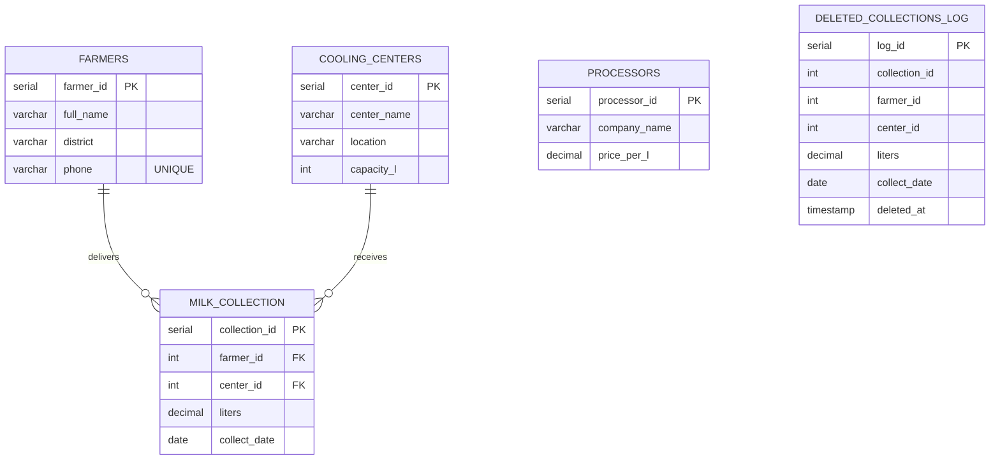

# Entity Relationship Diagram

GitHub draws this automatically. For the report, you can also take a screenshot and save it as `erd.png` in this folder (or export one from pgAdmin's ERD tool).

`processors` is an independent price list. `deleted_collections_log` has no foreign keys: a trigger fills it automatically whenever a row is deleted from `milk_collection`.
